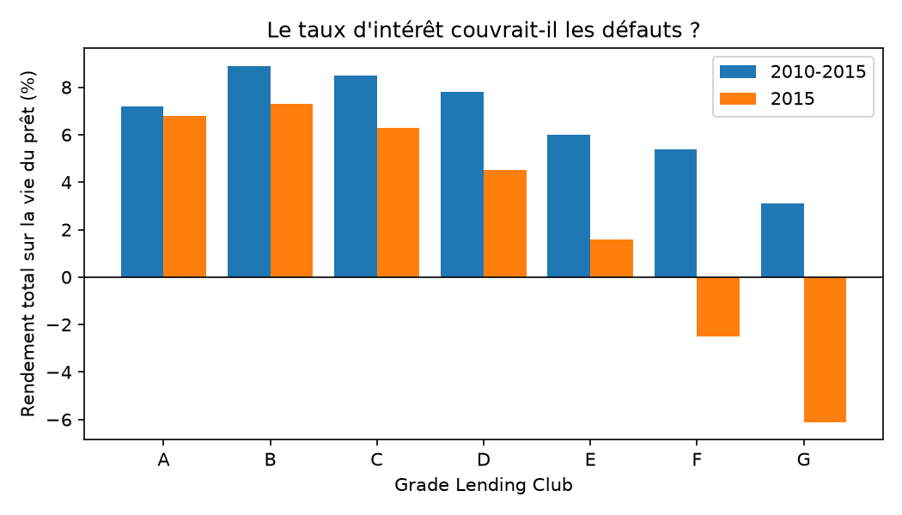
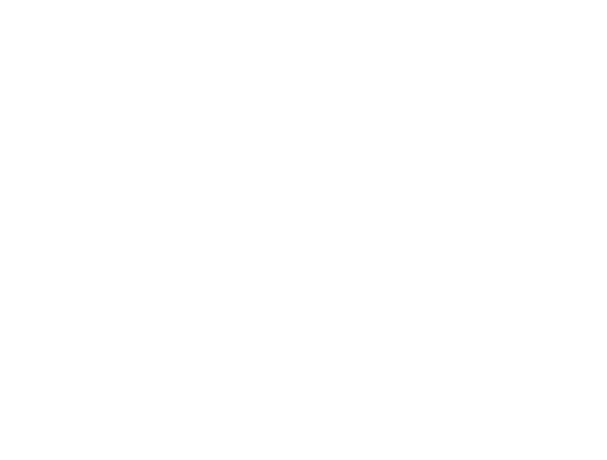
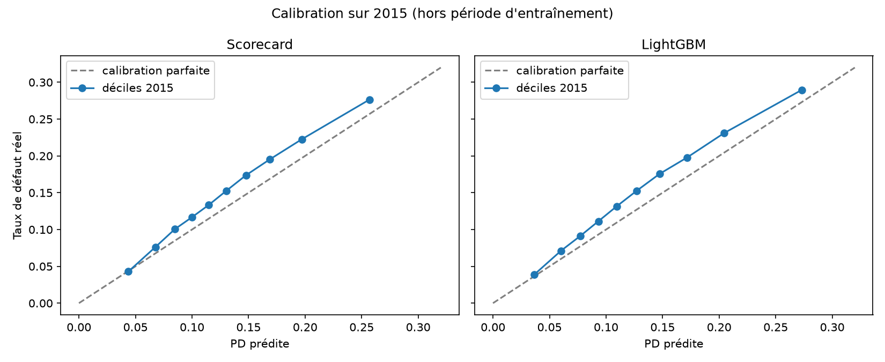

# Prêter à qui, et à quel prix ? Risque de crédit sur 612 000 prêts Lending Club

Ce projet construit un **modèle de probabilité de défaut (PD)** sur les prêts à la consommation de
36 mois accordés par Lending Club entre 2010 et 2015, en appliquant le **cadre réglementaire européen**
(définition du défaut de l'article 178 du CRR, formule de capital IRB). Le modèle est entraîné sur
2010-2014 et jugé sur **2015, une année qu'il n'a jamais vue**, puis prolongé jusqu'à la **perte
attendue** (PD × LGD × EAD), au **capital bâlois** et à la question qui intéresse le prêteur : *le taux
d'intérêt couvrait-il le risque ?*

**Résultats :**

- Notre **scorecard** classe correctement le futur défaut dans **65 % des paires** (Gini 0,303). Elle
  est parfaitement **stable dans le temps** (Gini 0,305 sur l'entraînement). Un **LightGBM** ne fait
  gagner que 0,03 point (0,331) et le **sous-grade de Lending Club**, qui disposait de plus
  d'informations, reste devant (0,357).
- Les deux modèles **sous-estiment de 12 %** les défauts de 2015. Cette dérive était **invisible** au
  contrôle de stabilité usuel (PSI = 0,000) : ce ne sont pas les clients qui ont changé, mais leur
  comportement. La perte attendue est sous-estimée de **16 %** (231 M$ prévus, 274 M$ constatés).
- **Le taux couvrait le risque en moyenne** : tous les grades ont été rentables sur 2010-2015. Mais
  **la prime de risque plafonne dès le grade B**, et en 2015 Lending Club a **baissé ses taux** alors
  que le défaut montait : les grades F et G ont **perdu de l'argent** (−2,5 % et −6,1 %).

**À retenir :** un modèle peut classer correctement les emprunteurs et se tromper de niveau de
risque. Les contrôles disponibles le jour de l'octroi ne le révèlent pas : il faut attendre trois ans
de défauts réels pour le voir.



---

## Sommaire

1. [Pourquoi ces données](#1-pourquoi-ces-données)
2. [Construire la cible : qu'est-ce qu'un défaut ?](#2-construire-la-cible--quest-ce-quun-défaut-)
3. [Le piège de la censure](#3-le-piège-de-la-censure)
4. [Uniquement ce que la banque savait le jour de l'octroi](#4-uniquement-ce-que-la-banque-savait-le-jour-de-loctroi)
5. [Ce que montrent les données](#5-ce-que-montrent-les-données)
6. [Le champion : une scorecard](#6-le-champion--une-scorecard)
7. [Le challenger : LightGBM](#7-le-challenger--lightgbm)
8. [Validation hors du temps](#8-validation-hors-du-temps)
9. [Perte attendue et capital bâlois](#9-perte-attendue-et-capital-bâlois)
10. [Le taux couvrait-il le risque ?](#10-le-taux-couvrait-il-le-risque-)
11. [Limites](#11-limites)
12. [Mes intuitions face aux données](#12-mes-intuitions-face-aux-données)
13. [Ce que j'ai appris](#13-ce-que-jai-appris)
14. [Reproduire le projet](#14-reproduire-le-projet)

---

## 1. Pourquoi ces données

**La question.** *Peut-on prédire, au moment où le prêt est accordé, quels emprunteurs ne
rembourseront pas ? Et le taux d'intérêt facturé couvrait-il vraiment la perte attendue ?*

**Les données.** [Lending Club](https://www.kaggle.com/datasets/wordsforthewise/lending-club),
2,26 millions de prêts américains accordés de 2007 à 2018, avec 151 colonnes. J'ai préféré ce jeu à
d'autres jeux publics de scoring parce qu'il contient les quatre éléments dont un analyste risque a
besoin :

| élément | colonne | sert à |
|---|---|---|
| date d'émission | `issue_d` | entraîner sur le passé, tester sur le futur |
| montants récupérés après défaut | `recoveries` | estimer la **LGD** |
| capital remboursé | `total_rec_prncp` | estimer l'**EAD** |
| taux et paiements | `int_rate`, `total_pymnt` | mesurer la **rentabilité** |

**Pourquoi des données américaines ?** C'est la première question que je me suis posée. Il n'existe
presque pas de données européennes publiques prêt par prêt : le secret bancaire et le RGPD
l'interdisent. L'European DataWarehouse collecte bien les prêts titrisés pour la BCE, mais son accès
est réservé aux professionnels. Le prêteur estonien Bondora publie ses données, mais le jeu est plus
petit et peu connu.

Les **méthodes**, elles, sont communes : les accords de Bâle sont internationaux et l'Union
européenne les applique via le règlement CRR. J'ai donc **appliqué le cadre européen** à ces données
américaines : définition du défaut de l'article 178 du CRR et formule IRB de l'article 154. Les écarts
entre les deux cadres sont signalés dans les [limites](#11-limites).

## 2. Construire la cible : qu'est-ce qu'un défaut ?

Le fichier ne contient que des prêts **acceptés**. Les refusés sont dans un autre fichier. La colonne
`loan_status` décrit donc la vie du prêt **après** l'octroi :

| statut | effectif | décision | raison |
|---|---:|---|---|
| Fully Paid | 1 076 751 | **sain** | remboursé |
| Current | 878 317 | exclu | en cours : l'issue est inconnue |
| Charged Off | 268 559 | **défaut** | passé en perte, vers 150 jours de retard |
| Late (31-120 days) | 21 467 | **défaut** | voir ci-dessous |
| In Grace Period | 8 436 | **sain** | moins de 15 jours de retard, se régularise presque toujours |
| Late (16-30 days) | 4 349 | exclu | issue trop incertaine |
| Does not meet the credit policy (×2) | 2 749 | exclu | accordés selon d'anciennes règles (2007-2010) |
| Default | 40 | **défaut** | plus de 120 jours de retard |

**Le cas difficile : « Late (31-120 days) ».** Le CRR fixe le défaut à **90 jours** de retard, et ce
statut mélange des prêts à 40 jours et à 110 jours. J'ai choisi de tous les compter en défaut :
- ceux qui ont dépassé 90 jours sont en défaut au sens réglementaire ;
- un emprunteur à plus de 30 jours de retard redevient rarement à jour ;
- face à l'incertitude, le régulateur demande que l'erreur aille **du côté prudent** (principe de
  conservatisme).

**Les « Does not meet the credit policy ».** Une banque ne calibre pas son modèle sur des clients
qu'elle n'accepterait plus aujourd'hui. Ces 2 749 prêts sont exclus.

**Un bug silencieux, et son garde-fou.** Ma première version avait un taux de défaut plausible
(21,09 %)… mais deux statuts avaient disparu sans aucun message d'erreur : `"Late(16-30 days)"`, écrit
sans espace, et `"Default"`, oublié dans mes listes. `map()` les avait transformés en valeurs
manquantes, puis `dropna()` les avait supprimés. Depuis, un `assert` vérifie que **chaque statut
présent dans les données est classé** quelque part. Les bugs les plus dangereux sont ceux qui ne
plantent pas.

## 3. Le piège de la censure

Sur l'ensemble des prêts au statut connu, le taux de défaut brut est de **21,1 %**. Mais par année
d'émission, il **monte** jusqu'en 2017 :



Ce n'est pas que les emprunteurs récents soient plus risqués. Fin 2018, quand les données s'arrêtent,
**86 % des prêts de 2018 sont encore en cours** (pointillés). Parmi les prêts déjà terminés, on trouve
surtout ceux qui ont **fait défaut vite** et ceux remboursés par anticipation. Exclure les
« Current » ne suffit donc pas : il faut ne garder que **les millésimes où tous les prêts ont eu le
temps d'arriver à échéance**.

Exemple : sur 100 prêts émis début 2017, environ 8 ont fait défaut et 12 ont été remboursés en avance
fin 2018, et 80 sont encore en cours. En excluant ces derniers, on mesure 8/20 = 40 % de défaut, au
lieu d'environ 15 % une fois tous les prêts terminés.

**Population retenue :**
- **36 mois uniquement**, soit 71 % des prêts. À 60 mois, il faudrait s'arrêter aux émissions de 2013
  et perdre les années les plus riches. Surtout, on ne mélange pas un taux de défaut « à 3 ans » et
  un taux « à 5 ans », pas plus qu'on ne mélange une VaR à 1 jour et une VaR à 10 jours.
- **Émis de 2010 à 2015.** Un prêt de 36 mois émis en décembre 2015 se termine en décembre 2018, le
  dernier mois des données. Avant 2010, il y a peu de prêts, la crise financière, et une politique
  d'octroi différente.

**Vérification :** sur ce périmètre, seuls **147 prêts sur 612 892** (0,02 %) ne sont pas terminés
(« Current », en retard ou en délai de grâce).
La population finale compte **612 125 prêts** et **13,91 %** de défaut : le chiffre brut était gonflé
d'environ 3 points par la censure.

| millésime | prêts | taux de défaut |
|---|---:|---:|
| 2010 | 8 466 | 9,9 % |
| 2011 | 14 101 | 10,6 % |
| 2012 | 43 470 | 13,6 % |
| 2013 | 100 422 | 12,3 % |
| 2014 | 162 570 | 13,7 % |
| 2015 | 283 096 | 14,9 % |

## 4. Uniquement ce que la banque savait le jour de l'octroi

C'est **la règle la plus importante du projet** : une variable n'entre dans le modèle que si la
banque la connaissait le jour où elle a dit oui. Sinon, le modèle « prédit » le défaut à partir
d'informations qui en sont la conséquence, et il affiche une performance spectaculaire qui ne vaut
rien en production.

**Huit exemples de fuite** présents dans le fichier :

| colonne | pourquoi elle est connue après coup |
|---|---|
| `recoveries` | sommes récupérées **après** le défaut, donc nulles pour tout prêt sain : la fuite parfaite |
| `total_pymnt` | total déjà remboursé |
| `out_prncp` | capital restant dû aujourd'hui |
| `last_pymnt_d` | date du dernier paiement |
| `last_fico_range_high` | score FICO **le plus récent**, qui chute quand l'emprunteur décroche |
| `total_rec_late_fee` | pénalités de retard encaissées |
| `debt_settlement_flag` | accord de règlement négocié après des impayés |
| `hardship_flag` | plan d'aide accordé à un emprunteur en difficulté |

**Chaque colonne chargée a un rôle :**

| rôle | colonnes | usage |
|---|---|---|
| **variables** (20) | FICO, revenu, endettement (`dti`), objet du prêt, statut de logement, ancienneté d'emploi, demandes de crédit récentes, utilisation des cartes… | entrent dans le modèle |
| **étalon** | `grade`, `sub_grade`, `int_rate` | **exclus du modèle**, servent de point de comparaison |
| **post-octroi** | `funded_amnt`, `total_rec_prncp`, `recoveries`, `collection_recovery_fee`, `total_pymnt` | **interdits au modèle**, réservés à la LGD et à la rentabilité |

**Pourquoi exclure le grade ?** Il est bien connu à l'octroi, mais c'est la **sortie du propre modèle
de risque de Lending Club**. Si on le donne à notre modèle, celui-ci va surtout le recopier, et on
mesurerait la performance de Lending Club au lieu de la nôtre. La vraie question devient : **fait-on
mieux que Lending Club avec les informations du dossier ?**

**Une fuite indirecte : `installment`.** La mensualité dépend du montant, de la durée et du **taux**.
La durée étant fixée à 36 mois, le rapport mensualité / montant **redonne exactement le taux**, donc
le grade. Elle est exclue aussi.

## 5. Ce que montrent les données

**Le grade de Lending Club trie très bien les emprunteurs.**

| grade | prêts | taux de défaut |
|---|---:|---:|
| A | 141 388 | 5,5 % |
| B | 209 730 | 11,2 % |
| C | 160 119 | 17,9 % |
| D | 75 141 | 23,4 % |
| E | 21 081 | 28,7 % |
| F | 4 173 | 33,0 % |
| G | 493 | 40,0 % |

Le taux monte à chaque marche, et il y a un **rapport de 7** entre A et G. Le **score FICO seul**
sépare moins bien : 18,3 % de défaut sous 680, contre 5,2 % au-dessus de 750, soit un rapport de 3,5.
Le grade combine le FICO avec d'autres informations : **c'est la barre à franchir**.

**Valeurs manquantes.** `emp_length` (ancienneté d'emploi, 5,9 %) et `mort_acc` (nombre de crédits
immobiliers, 4,7 %). Un manquant n'est pas un hasard : un emploi non déclaré dit quelque chose. Les
manquants forment donc **leur propre classe**, au lieu d'être remplacés par une moyenne.

**Découpage dans le temps.** Entraînement sur **2010-2014** (329 029 prêts, 13,05 % de défaut), test
sur **2015** (283 096 prêts, 14,90 %). C'est un test **hors du temps**, comme le backtesting d'une
VaR : le modèle est jugé sur une période qu'il n'a jamais vue.

## 6. Le champion : une scorecard

C'est le modèle standard du crédit à la consommation depuis quarante ans. Il fonctionne en trois
temps.

**1. Découper chaque variable en classes et mesurer le WoE.** Par exemple, 10 tranches de FICO. Pour
chaque classe, le *Weight of Evidence* compare la part des bons payeurs à la part des défauts :
WoE = ln(% des bons payeurs / % des défauts). Si une classe contient 40 % des bons payeurs mais 60 %
des défauts, son WoE vaut ln(40/60) = −0,41 : la classe est risquée.

| FICO | prêts | taux de défaut | WoE |
|---|---:|---:|---:|
| ≤ 665 | 55 828 | 18,0 % | −0,38 |
| 665-680 | 80 138 | 15,4 à 17,1 % | −0,32 à −0,19 |
| 680-705 | 100 382 | 11,4 à 13,8 % | −0,07 à +0,15 |
| 705-740 | 63 420 | 7,8 à 9,5 % | +0,35 à +0,57 |
| > 740 | 29 261 | 5,3 % | **+0,99** |

Le WoE est **strictement croissant** : plus le score est élevé, plus la classe est sûre. Et il
**accélère** en haut de l'échelle : les très bons scores sont *très* sûrs.

**2. Trier les variables avec l'IV.** L'*Information Value* additionne les écarts de toutes les
classes : c'est le **pouvoir de tri** d'une variable à elle seule. On garde les variables au-dessus
de 0,02, et un IV supérieur à 0,5 doit faire **soupçonner une fuite**.

| variable | IV | | variable | IV |
|---|---:|---|---|---:|
| FICO | **0,142** | | demandes de crédit (6 mois) | 0,029 |
| revenu annuel | 0,087 | | utilisation des cartes | 0,025 |
| taux d'endettement | 0,048 | | objet du prêt | 0,024 |
| crédits immobiliers | 0,045 | | *ancienneté du 1er crédit* | *0,018* |
| montant / revenu | 0,043 | | *État de résidence* | *0,015* |
| statut de logement | 0,037 | | *incidents de paiement (2 ans)* | *0,002* |

**9 variables retenues sur 21.** Aucune n'est forte seule : la performance vient de leur
combinaison. Aucune ne dépasse 0,5 : **le tri anti-fuite a fonctionné**.

**La surprise : les incidents de paiement ne prédisent presque rien** (IV de 0,002). C'est un **biais
de sélection** : on n'observe que les prêts **acceptés**. Les candidats aux lourds antécédents ont été
refusés, et ceux qui restent avec un incident avaient forcément d'autres points forts. **Un modèle ne
peut pas apprendre sur les gens auxquels on n'a jamais prêté.** Les banques appellent ce problème la
*reject inference*.

**3. Une régression logistique sur les WoE.** Tous les coefficients sont **négatifs** : un WoE élevé
signale une classe sûre, il fait donc baisser la probabilité de défaut. Un coefficient proche de −1
signifie que la variable apporte une information propre. Les demandes de crédit récentes (−1,10) et
l'objet du prêt (−0,97) apportent ce que le FICO ne voit pas encore. L'utilisation des cartes (−0,15)
fait au contraire presque doublon avec le FICO.

**Le résultat se lit comme un permis à points.** On peut expliquer chaque refus à un client (« vous
avez perdu des points parce que vous avez fait plusieurs demandes de crédit récentes »), ce que le
régulateur européen exige.

**Comment lire le Gini.** On prend au hasard un emprunteur qui a fait défaut et un qui a remboursé, et
on regarde si le modèle a donné la PD la plus haute au premier. L'**AUC** est la proportion de paires
où le modèle a raison : 50 % pour le hasard, 100 % pour un modèle parfait. Le **Gini** remet cette
échelle entre 0 et 1, avec Gini = 2 × AUC − 1.

| modèle | Gini train | Gini test 2015 | AUC test |
|---|---:|---:|---:|
| scorecard | 0,305 | **0,303** | 65 % |
| sous-grade Lending Club | — | 0,357 | 68 % |

Un Gini de 0,3 à 0,5 est normal pour un score d'octroi en crédit à la consommation : on ne peut pas
prévoir une perte d'emploi ou un divorce trois ans à l'avance. L'écart entre entraînement et test est
**nul**. Avec 9 variables découpées en classes, le modèle est trop simple pour apprendre par cœur, et
il **tient dans le temps**. Lending Club fait mieux parce qu'il disposait du dossier de crédit complet,
dont nous ne voyons qu'un résumé.

## 7. Le challenger : LightGBM

LightGBM construit des centaines de petits arbres de décision, chacun corrigeant les erreurs laissées
par les précédents. On parle de **boosting**. Il capte des **interactions** que la scorecard ne voit
pas, comme « FICO moyen **et** endettement élevé », mais il n'est pas explicable simplement.

**Arrêt anticipé.** Les arbres sont construits sur 2010-2013. Après chacun, on mesure la **log-perte**
sur 2014. On s'arrête quand 100 arbres de suite ne l'améliorent plus, et **2015 n'est jamais
consulté**. J'ai choisi la log-perte plutôt que l'AUC : l'AUC ne juge que l'ordre des emprunteurs et
peut cesser de progresser très tôt, alors que la log-perte juge aussi le niveau des probabilités.
**383 arbres** ont été retenus.

**Résultat : Gini 0,330.** C'est mieux que la scorecard (+0,027), mais moins bien que Lending Club.
La limite ne vient pas de l'outil, mais **des informations disponibles** : un modèle plus puissant ne
crée pas d'information.

**Le test d'ablation sur `addr_state`.** Dans l'importance des variables, l'État de résidence arrivait
en **2e position**, juste derrière le FICO, alors que son IV (0,015) l'avait fait juger inutile dans
la scorecard. J'ai relancé le modèle sans lui :

| | Gini 2015 |
|---|---:|
| avec `addr_state` | 0,330 |
| sans `addr_state` | **0,331** |

Le Gini ne bouge pas. **L'importance affichée par LightGBM mesure combien une variable est utilisée,
pas combien elle est utile.** Avec 50 catégories, l'algorithme trouve toujours des regroupements
d'États qui collent au bruit de l'entraînement. La variable est retirée : on ne perd rien, et on évite
un critère géographique qui ressemblerait au *redlining*, ces refus de crédit fondés sur le quartier,
illégaux aux États-Unis comme en Europe.

## 8. Validation hors du temps

| modèle | Gini | KS | PD moyenne prédite | PSI 2010-14 → 2015 |
|---|---:|---:|---:|---:|
| scorecard | 0,303 | 0,218 | 13,1 % | 0,000 |
| LightGBM | 0,331 | 0,240 | 13,0 % | 0,001 |
| sous-grade Lending Club | 0,357 | 0,262 | — | — |
| **taux de défaut réel 2015** | | | **14,9 %** | |

- Le **KS** (Kolmogorov-Smirnov) mesure l'écart maximal entre les distributions de score des défauts
  et des bons payeurs, autrement dit le meilleur pouvoir de séparation. Il confirme le classement.
- Le **PSI** (*Population Stability Index*) compare la distribution des scores de 2015 à celle de
  l'entraînement. Il est inférieur à 0,10 : **la population est stable**.

**La calibration.** Le Gini juge l'**ordre** des emprunteurs ; la calibration juge le **niveau** des
probabilités. Les deux modèles prédisent 13 % de défaut là où il y en a eu 14,9 %.



La courbe est **parallèle à la diagonale**. La sous-estimation est d'environ 10 à 15 % en proportion
dans presque tous les déciles. Le modèle a donc la bonne **forme**, seul son **niveau** est faux.

**Pourquoi ? Une dérive conceptuelle.** Ma première hypothèse était que Lending Club, en croissance
très rapide, avait recruté des clients de moins bonne qualité. C'est vrai entre 2010 et 2013 : le
FICO moyen passe de 715 à 695. Mais le PSI nul m'a obligé à vérifier pour 2015 :

| | 2014 | 2015 |
|---|---:|---:|
| FICO moyen | 692 | 694 |
| taux de défaut, grade C | 17,2 % | **19,5 %** |
| taux de défaut, grade D | 22,2 % | **26,2 %** |

Les dossiers de 2015 **ressemblent** à ceux de 2014. Ce sont **les mêmes profils qui ont fait plus
défaut**. Il faut distinguer deux types de dérive :
- la **dérive de population** : les clients changent. Le PSI la détecte le jour même, sur les dossiers ;
- la **dérive conceptuelle** : les clients sont les mêmes, mais leur comportement change. Le PSI est
  **aveugle** à ce type de dérive, qu'on ne voit qu'en comparant les PD aux défauts réels, donc **trois
  ans plus tard**.

Une explication souvent avancée est la multiplication des prêteurs en ligne : un emprunteur pouvait
souscrire plusieurs prêts sur plusieurs plateformes avant que cela n'apparaisse dans son dossier de
crédit. Nos données ne permettent pas de le vérifier. C'est précisément pourquoi l'EBA impose de
**backtester les PD chaque année** et d'ajouter une **marge de conservatisme** : un PSI vert ne
garantit pas des PD justes.

**Le choix du champion.** J'ai d'abord penché pour LightGBM, plus précis. Mais il ne gagne que 0,03
point de Gini, avec la même erreur de calibration, au prix de 381 arbres inexplicables. Pour un
modèle qui sert au **capital réglementaire**, cet écart ne justifie pas de sacrifier l'explicabilité.
**La scorecard est le champion**, et LightGBM reste le challenger qui mesure en continu le prix de
cette simplicité.

## 9. Perte attendue et capital bâlois

Pour passer d'une probabilité à des dollars, il faut deux autres briques :
- la **LGD** (*Loss Given Default*) : la part de l'argent perdue quand le prêt fait défaut ;
- l'**EAD** (*Exposure at Default*) : le montant encore dû au moment du défaut.

Les deux sont estimées sur les défauts de 2010-2014 :

| paramètre | valeur | lecture |
|---|---:|---|
| LGD | **89,0 %** | on ne récupère que 11 centimes par dollar |
| EAD | 57,4 % du montant initial | les emprunteurs ont tenu environ un an avant de décrocher |

Une LGD de 89 % est typique d'un prêt **sans garantie** : il n'y a rien à saisir, et la créance est
revendue à des sociétés de recouvrement pour presque rien. Un crédit immobilier, protégé par
l'hypothèque, a une LGD de l'ordre de 10 à 25 %.

**Perte attendue (EL = PD × LGD × EAD) sur les prêts de 2015 :**

| | montant | en % du prêté |
|---|---:|---:|
| montant prêté | 3 625 M$ | |
| perte attendue par le modèle | 231 M$ | 6,37 % |
| **perte réellement constatée** | **274 M$** | **7,56 %** |

C'est un **backtest de la perte attendue** : elle est sous-estimée de 16 %. Une banque utilisant ce
modèle aurait **sous-provisionné de 43 M$**, essentiellement à cause de la dérive de la PD.

**Capital réglementaire.** La perte attendue est couverte par le taux et les provisions. Le capital
couvre l'**inattendu** : la perte qu'on ne dépasserait qu'une fois sur 1 000 (quantile à 99,9 %),
diminuée de la perte attendue. C'est le même raisonnement qu'une VaR. J'ai utilisé la formule IRB
« autre clientèle de détail » du CRR (article 154), avec une PD convertie de 3 ans à 1 an et un
plancher à 0,05 %.

| | capital | en % du prêté |
|---|---:|---:|
| avec la PD du modèle | 368 M$ | 10,15 % |
| avec la PD corrigée a posteriori (× 1,136) | 377 M$ | 10,39 % |

Pour accorder ces prêts, il fallait donc mobiliser l'équivalent de **16,5 % du montant prêté** : 6,4 %
de pertes normales et 10,2 % de coussin. **Corriger la PD de 13,6 % ne relève le capital que de
2,4 %** : la formule de Bâle s'aplatit pour les PD élevées, car une plus grande part de la perte y
devient attendue plutôt qu'inattendue. **L'erreur de calibration coûte surtout en provisions et en
tarification, peu en capital.**

## 10. Le taux couvrait-il le risque ?

**Rendement total** sur la vie du prêt = (tout ce qui a été remboursé ou récupéré − frais de
recouvrement) / montant prêté − 1.

| grade | taux moyen | défaut | rendement 2010-2015 | taux 2015 | défaut 2015 | rendement 2015 |
|---|---:|---:|---:|---:|---:|---:|
| A | 7,2 % | 5,5 % | +7,2 % | 6,9 % | 5,4 % | +6,8 % |
| B | 10,9 % | 11,2 % | **+8,9 %** | 10,0 % | 11,9 % | +7,3 % |
| C | 13,9 % | 17,9 % | +8,5 % | 13,2 % | 19,5 % | +6,3 % |
| D | 17,2 % | 23,4 % | +7,8 % | 16,6 % | 26,2 % | +4,5 % |
| E | 19,9 % | 28,7 % | +6,0 % | 19,1 % | 32,8 % | +1,6 % |
| F | 23,8 % | 33,0 % | +5,4 % | 23,5 % | 42,5 % | **−2,5 %** |
| G | 26,0 % | 40,0 % | +3,1 % | 26,9 % | 45,9 % | **−6,1 %** |

**Trois constats :**
1. **En moyenne, oui** : tous les grades ont été rentables sur 2010-2015. Notre population ne compte
   d'ailleurs aucun grade à 100 % de défaut : aucun taux ne pourrait le compenser.
2. **La prime de risque plafonne dès le grade B.** Le rendement monte de A à B, puis **redescend**
   jusqu'à G. A est sûr mais trop peu rémunéré ; au-delà de B, chaque grade prend plus de risque pour
   rapporter moins. Un investisseur rationnel ne devrait jamais préférer G à B.
3. **En 2015, Lending Club a baissé ses taux** (B : 10,9 % → 10,0 % ; D : 17,2 % → 16,6 %) **alors
   que le défaut montait**. Les grades F et G ont perdu de l'argent. Face à la concurrence, la
   plateforme fixait ses prix avec des modèles appris sur le passé, comme le nôtre : elle avait
   **le même angle mort** sur la dérive de 2015, et elle a baissé ses prix au pire moment.

*Précisions :* ce rendement n'est pas annualisé (le capital est remboursé progressivement sur 3 ans)
et ne déduit pas les frais de service de Lending Club (1 % des paiements). Les ordres de grandeur et
le classement entre grades restent valables.

## 11. Limites

- **Données américaines.** Le score FICO n'existe pas en Europe, où les banques utilisent leurs
  propres scores internes. La définition « Charged Off » de Lending Club (environ 150 jours) n'est pas
  exactement celle du CRR (90 jours), et le critère d'« improbabilité de paiement » de l'EBA n'est
  pas observable ici.
- **Biais de sélection.** Le modèle n'a vu que des prêts acceptés. Le fichier des demandes refusées
  permettrait une *reject inference*.
- **Horizon.** La cible est un défaut sur 36 mois ; la conversion en PD à 1 an pour le capital
  suppose un risque constant chaque année, alors que les défauts sont concentrés sur la première
  année.
- **LGD.** Une moyenne unique, sans version « downturn » (en période de crise) exigée par l'EBA, ni
  modèle par profil d'emprunteur.
- **Calibration.** Le facteur de correction × 1,136 est mesuré **après coup** sur 2015. En pratique, il
  faudrait le fixer à l'avance avec une marge de conservatisme justifiée.
- **Périmètre.** Les prêts de 60 mois ne sont pas modélisés.

**Pistes d'amélioration :** reject inference avec le fichier des refusés, modèle de LGD, test de
calibration par grade (test binomial), prêts de 60 mois avec un modèle de survie, recalibration
annuelle avec marge de conservatisme.

## 12. Mes intuitions face aux données

Avant chaque résultat, j'ai noté ma prédiction. Les écarts sont ce qui m'a le plus appris.

| question | ma prédiction | réalité | ce que j'en retiens |
|---|---|---|---|
| taux de défaut des 36 mois arrivés à terme | 10 %, puis 20 % après avoir vu le brut | **13,9 %** | le chiffre brut (16,9 %) était gonflé par la censure |
| défaut du grade A / du grade G | 0 % / 100 %, puis 5 % / 50-60 % | **5,5 % / 40 %** | à 100 % de défaut, aucun taux ne compense : le prêteur n'aurait pas prêté |
| écart de défaut entre FICO bas et FICO haut | × 10 | **× 3,5** | le FICO seul trie moins bien que le grade (× 7) |
| variable au plus grand IV | le FICO | **le FICO (0,142)** | mais aucune variable n'est forte seule |
| signe des coefficients | positif | **négatif** | le modèle prédit le défaut ; un WoE élevé signale une classe sûre |
| Gini test vs train | test plus bas | **identique** | un modèle simple ne peut pas apprendre par cœur |
| notre modèle bat-il Lending Club ? | non, il a plus d'informations | **non** (0,303 contre 0,357) | |
| PD moyenne 2015 | sous le taux réel | **13,1 % contre 14,9 %** | le modèle a appris un monde à 13 % de défaut |
| LightGBM bat-il la scorecard ? | oui | **oui, de 0,03 seulement** | la limite, c'est l'information, pas l'outil |
| Gini sans `addr_state` | un peu plus bas | **inchangé** | importance ≠ utilité |
| PSI 2015 | instable | **0,000** | les clients étaient les mêmes, leur comportement a changé |
| LGD d'un prêt sans garantie | 60 % | **89 %** | sans garantie, on ne récupère presque rien |
| grade le plus rentable | A | **B** | la prime de risque plafonne vite |
| taux de Lending Club en 2015 | en hausse | **en baisse** | un prêteur en course à la croissance ne se comporte pas comme un prêteur prudent |

## 13. Ce que j'ai appris

- **Définir la cible est une décision de modélisation, pas une formalité.** Où placer les retards de
  31 à 120 jours ? Que faire des prêts accordés sous d'anciennes règles ? Chaque choix doit être
  justifié, et dans le doute, il va du côté prudent.
- **Le temps est partout.** La censure fausse les taux de défaut récents. Le test doit porter sur une
  période future, et une variable n'est légitime que si elle était connue au moment de la décision.
- **Un résultat trop beau est un signal d'alarme.** L'IV et le test d'ablation servent autant à
  détecter les erreurs qu'à mesurer la performance.
- **Classer et calibrer sont deux qualités différentes.** Mon modèle classait aussi bien en 2015 qu'en
  2014, mais se trompait de 12 % sur le niveau. En banque, c'est le niveau qui fixe les provisions, le
  capital et le prix.
- **Les contrôles de stabilité ne voient pas tout.** Le PSI était parfait alors que le risque montait :
  seul le backtest sur les défauts réels le révèle.
- **Un modèle plus complexe n'est pas forcément meilleur pour une banque.** 0,03 point de Gini ne vaut
  pas la perte d'explicabilité quand un client refusé ou un superviseur demande pourquoi.
- **Des bugs silencieux.** Un statut mal orthographié peut supprimer 4 349 lignes sans aucun message
  d'erreur. Un `assert` coûte une ligne.

## 14. Reproduire le projet

**Données.** Télécharger `accepted_2007_to_2018Q4.csv.gz` (environ 400 Mo) depuis
[Kaggle](https://www.kaggle.com/datasets/wordsforthewise/lending-club) (compte gratuit requis) et le
placer dans `data/`, sans le décompresser.

**Environnement** (Python 3.13) :
```
python -m venv .venv
.\.venv\Scripts\Activate.ps1        # Windows ; sous macOS/Linux : source .venv/bin/activate
pip install -r requirements.txt
python -m jupyter lab
```

**Exécution**, dans l'ordre :
1. `01_donnees.ipynb` (environ 3 minutes) : statuts, cible, censure, population ; écrit
   `data/population.parquet`.
2. `02_modeles.ipynb` (environ 1 minute) : WoE/IV, scorecard, LightGBM, validation, perte attendue,
   capital, rentabilité.

**Structure :**
```
01_donnees.ipynb        données, cible, censure, population
02_modeles.ipynb        modèles, validation, EL, capital, tarification
figures/                graphiques du README
data/                   données (non versionnées, voir ci-dessus)
requirements.txt
```
